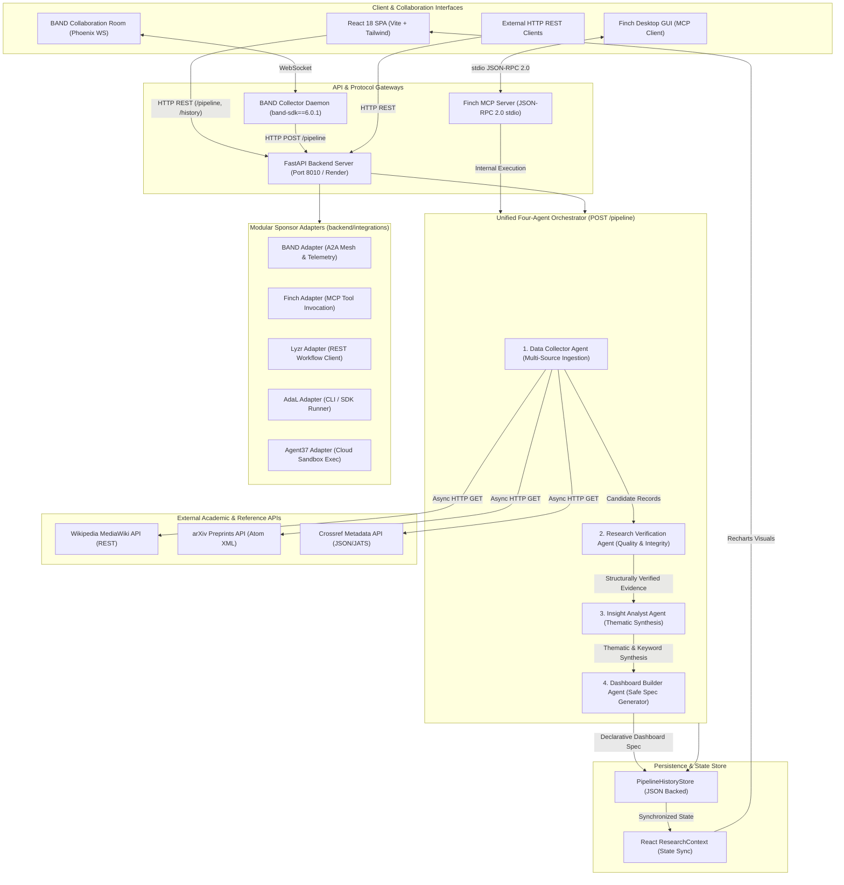
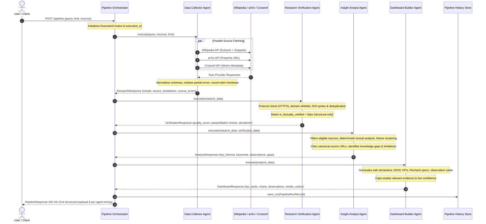
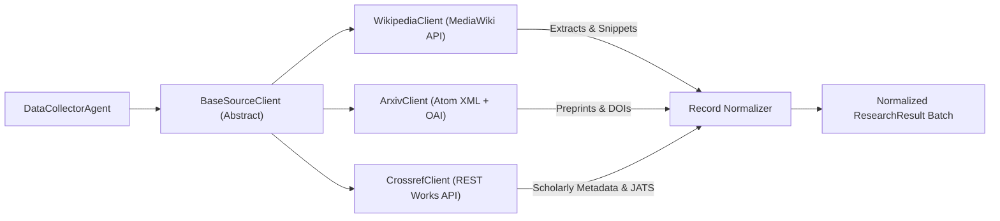
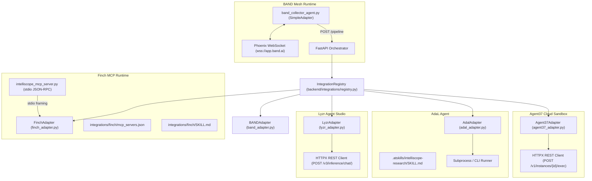

# IntelliScope AI — System Architecture

**IntelliScope AI** is an autonomous multi-agent research intelligence platform designed to eliminate information overload and hallucinated summaries. It decouples research collection, structural verification, deterministic analysis, and visual dashboard generation into four specialized, cooperative agents orchestrated sequentially or triggered via multi-channel sponsor interfaces.

---

## 1. High-Level System Architecture

The following diagram illustrates the complete end-to-end system topology, including the external research providers, the core four-agent pipeline, the persistence layer, the frontend visualization engine, and the external sponsor interfaces.



---

## 2. Four-Agent Execution Sequence

The unified multi-agent pipeline (`POST /pipeline`) coordinates execution with strict isolation, execution correlation IDs (`execution_id`), and per-step timeouts (`PIPELINE_STEP_TIMEOUT_SECONDS`).



---

## 3. Data Flow & Schema Contracts

Each agent operates on typed Pydantic models. No downstream agent accesses raw unvalidated external payloads.

```
┌────────────────────────────────────────────────────────────────────────┐
│ 1. Data Collector Agent (backend/agents/data_agent.py)                 │
│ Output: ResearchResponse                                               │
│ - query: str                                                           │
│ - result_count: int                                                    │
│ - sources_requested: list[str] ("wikipedia", "arxiv", "crossref")      │
│ - source_breakdown: dict[str, int]                                     │
│ - source_errors: dict[str, str] (isolated partial provider failures)   │
│ - results: list[ResearchResult] (normalized title, snippet, abstract,  │
│   source_url, publication_date, doi, authors, source_name)             │
└───────────────────────────────────┬────────────────────────────────────┘
                                    │
                                    ▼
┌────────────────────────────────────────────────────────────────────────┐
│ 2. Research Verification Agent (backend/agents/verification_agent.py)  │
│ Input: ResearchResponse                                                │
│ Output: VerificationResponse                                           │
│ - quality_score: float (0.0 to 100.0)                                  │
│ - valid_results_count: int / invalid_results_count: int                │
│ - is_factually_verified: bool = False (mandatory structural boundary)  │
│ - factual_accuracy_disclaimer: str                                     │
│ - results: list[VerificationResultItem] (item_score, checks)           │
│   - checks: https_valid, domain_allowed, doi_valid, is_duplicate_url   │
└───────────────────────────────────┬────────────────────────────────────┘
                                    │
                                    ▼
┌────────────────────────────────────────────────────────────────────────┐
│ 3. Insight Analyst Agent (backend/agents/analyst_agent.py)             │
│ Input: ResearchResponse + VerificationResponse                         │
│ Output: AnalysisResponse                                               │
│ - eligible_sources_count: int / excluded_sources_count: int            │
│ - key_themes: list[ThemeCluster] (theme, description, frequency, urls) │
│ - important_keywords: list[str] (frequency-weighted lexical extraction)│
│ - evidence_backed_observations: list[EvidenceObservation]              │
│   - statement, source_title, source_url, confidence ("high"|"med"|"low")│
│   - is_weakly_relevant: bool                                           │
│ - information_gaps: list[str] / limitations: list[str]                 │
└───────────────────────────────────┬────────────────────────────────────┘
                                    │
                                    ▼
┌────────────────────────────────────────────────────────────────────────┐
│ 4. Dashboard Builder Agent (backend/agents/dashboard_builder_agent.py) │
│ Input: AnalysisResponse                                                │
│ Output: DashboardResponse                                              │
│ - kpi_cards: list[KPICard] ("Structurally Eligible Sources", etc.)     │
│ - charts: list[ChartSpecification] (pie, bar, horizontal_bar)          │
│   - chart-source-eligibility, chart-theme-distribution, keyword-chart   │
│ - observations: list[ObservationCard] (capped confidence for weak ev)  │
│ - render_notice: str (safe specification guarantee)                    │
└────────────────────────────────────────────────────────────────────────┘
```

---

## 4. Multi-Source Provider Architecture

Data ingestion is handled by modular clients residing in `backend/services/sources/`:



### Provider Details & Error Handling:
1. **Wikipedia Client (`backend/services/sources/wikipedia_client.py`)**:
   - Queries `https://en.wikipedia.org/w/api.php` using `query` and `extracts` modules.
   - Cleans HTML markup, strips citation tags (`[1]`, `[citation needed]`), and fetches canonical page URLs.
2. **arXiv Client (`backend/services/sources/arxiv_client.py`)**:
   - Queries `https://export.arxiv.org/api/query` via asynchronous HTTP.
   - Parses Atom XML responses, extracting primary authors, publication dates, abstracts, and `arxiv:doi` attributes.
3. **Crossref Client (`backend/services/sources/crossref_client.py`)**:
   - Queries `https://api.crossref.org/works` using mailto headers for polite pool access.
   - Parses JATS XML abstracts or logs an honest metadata fallback (journal, ISSN, DOI) when abstract text is restricted.
4. **Resilient Round-Robin & Partial Failure Isolation**:
   - Records are interleaved fairly across active sources.
   - If one provider encounters a rate limit (`429`) or timeout (`504`), the error is recorded in `source_errors`, allowing healthy providers to complete the research run without crashing the pipeline.

---

## 5. Epistemic Integrity: Structural vs Topical vs Factual

A foundational architectural requirement of IntelliScope AI is maintaining strict epistemic boundaries. Unverified data is never presented as factual proof.

```mermaid
flowchart TD
    Raw["Raw Ingested Records"] --> Gate1["1. Structural Verification (VerificationAgent)"]
    
    subgraph StructuralChecks ["Structural Verification Checks"]
        C1["HTTPS Protocol Check"]
        C2["Domain Whitelist (*.wikipedia.org, arxiv.org, doi.org)"]
        C3["DOI Syntax Check (10.xxxx/...) & Deduplication"]
        C4["Title & URL Deduplication"]
        C5["ISO 8601 Timestamp Validation"]
    end
    Gate1 --> StructuralChecks

    StructuralChecks --> Score["Calculates Quality Score (0-100)"]
    Score --> Flag["is_factually_verified = FALSE"]
    
    Flag --> Gate2["2. Topical Relevance Analysis (InsightAnalystAgent)"]
    
    subgraph RelevanceChecks ["Topical Relevance Evaluation"]
        R1["Domain Vocabulary & Keyword Overlap"]
        R2["Direct Relevance: Strong title/abstract semantic alignment"]
        R3["Weak Relevance: Peripheral mention / broad context"]
    end
    Gate2 --> RelevanceChecks

    RelevanceChecks --> Gate3["3. Confidence & Evidence Gating (DashboardBuilderAgent)"]
    
    subgraph ConfidenceGating ["Presentation & Confidence Rules"]
        G1["Direct Relevant Evidence -> High / Medium Confidence"]
        G2["Weakly Relevant Evidence -> Strictly Capped to Low Confidence"]
        G3["Thematic Citations -> Explicitly Marked as Overlapping"]
        G4["Mandatory Factual Accuracy Disclaimer Displayed"]
    end
    Gate3 --> ConfidenceGating
```



---

## 6. Dashboard Generation Flow & Safe Declarative Specifications

The **Dashboard Builder Agent** does not produce executable JavaScript or unsafe HTML. Instead, it compiles an immutable, declarative JSON specification rendered deterministically by React components:

1. **KPI Cards**:
   - `kpi-total-sources`: Total candidate sources evaluated.
   - `kpi-eligible-sources`: Structurally eligible sources passing HTTPS, domain, and deduplication rules.
   - `kpi-excluded-sources`: Excluded or duplicate sources rejected by verification.
   - `kpi-theme-count`: Thematic clusters identified across evidence.
2. **Chart Specifications**:
   - `chart-source-eligibility`: Pie chart showing structural eligibility breakdown.
   - `chart-theme-distribution`: Horizontal bar chart of citations per theme (annotated as overlapping).
   - `chart-keyword-frequency`: Vertical bar chart of prominent keyword occurrences with explicit heuristic disclosures.
3. **Observation Cards**:
   - Direct quotes and summaries grounded with canonical HTTPS links, author lists, DOIs, and confidence ratings.
4. **Frontend Safe Rendering**:
   - Frontend components (`Recharts`, Tailwind CSS) map specification IDs and data series directly into presentation components without using `dangerouslySetInnerHTML` or `eval()`.

---

## 7. Sponsor Integration Architecture

IntelliScope AI implements modular adapters under `backend/integrations/` adhering to the `BaseIntegrationAdapter` contract, ensuring consistent lifecycle management, health probing, and inter-agent handoffs.



### Integration Status Matrix:
- **BAND (Mandatory — Implemented / Partially Live Verified)**: Official `band-sdk==6.0.1` event loop, WebSocket reconnect watchdog, live REST auth (`get_agent_me` 200 OK), and room discovery (`c348c418-f3a6-467d-8601-c7453bec68e1`). Full `LIVE TESTED` classification requires an active host background daemon connected via WebSocket demonstrating a fresh inbound-to-outbound room turn (`scripts/live_band_room_test.py`).
- **Finch (Mandatory — Implemented)**: MCP stdio server with JSON-RPC 2.0 framing, implementing 4 tools (`intelliscope_research`, `intelliscope_verify`, `intelliscope_pipeline`, `intelliscope_integrations_status`). Tested locally with JSON-RPC handshake checks.
- **Lyzr (Mandatory — Partial, Not Live-Configured)**: Modular adapter implemented and tested with HTTPX mocks. Explicitly disclosed as not live-configured due to absent `LYZR_API_KEY` in environment.
- **AdaL (Mandatory — Partial, Not Live-Configured)**: Project skill defined in `.atskills/intelliscope-research/SKILL.md` and CLI runner implemented. Explicitly disclosed as not live-configured due to absent `adal` CLI on host.
- **Agent37 (Optional Prize Track — Partial, Not Live-Configured)**: Modular adapter implemented and tested with HTTPX mocks. Explicitly disclosed as not live-configured due to absent `AGENT37_API_KEY`.

---

## 8. Deployment Topology

The production application is deployed on Render using an isolated hybrid topology that honors free-tier limitations:

1. **Frontend**: Render Free Static Site (`https://intelliscope-frontend.onrender.com`), serving precompiled React 18 / Vite static bundles globally via CDN with SPA rewrite rules (`/* -> /index.html`).
2. **Backend**: Render Free Web Service (`https://intelliscope-backend.onrender.com`), running FastAPI on Python 3.12, binding dynamically to `$PORT` and listening on `0.0.0.0`.
3. **Local Dev & Development Port Isolation**: Port `8010` is preserved for local backend development, strictly avoiding port `8000` to prevent interference with independent developer services (e.g., AID-DRAS).
4. **Persistent BAND Collector**: Operates as a background daemon on the developer's Linux host or dedicated server, maintaining the long-lived Phoenix WebSocket connection to `wss://app.band.ai` and dispatching incoming research requests to the Render backend over HTTPS.

